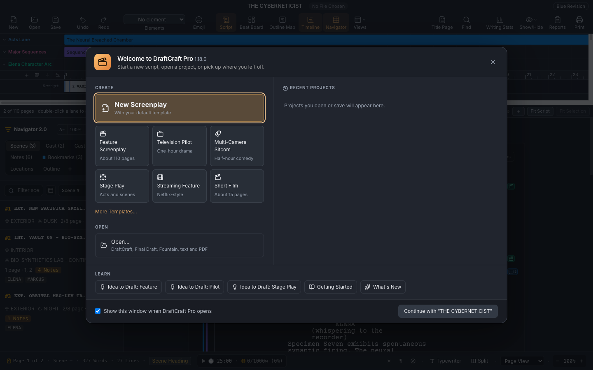
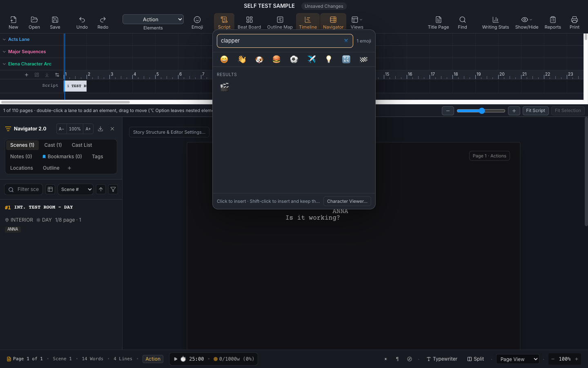

# DraftCraft Pro

A screenplay writing app for macOS and Windows, inspired by Final Draft. It is built with Electron, React and
TypeScript, and it is open source under the [MIT licence](LICENSE).

**Current version: 1.18.0**, for macOS 13 or later on Apple Silicon, and Windows 10 or 11 (64-bit).

| Start Window | Emoji picker |
|---|---|
|  |  |

## Download and install

Get the files from the [Releases](../../releases) page.

### Windows

Run **`DraftCraft-Pro-1.18.0-x64-Setup.exe`**. It installs for your user account, with no administrator rights
needed, and adds a Start menu shortcut. If you'd rather not install, use the portable zip instead. The app is not
code-signed, so SmartScreen may show "Windows protected your PC": click **More info**, then **Run anyway**.
[WINDOWS.md](WINDOWS.md) covers installing, what differs on Windows, and building it yourself.

### Mac

1. Download **`DraftCraft-Pro-1.18.0-arm64.dmg`**.
2. Open the disk image and double-click **`Install-DraftCraft.command`**. It checks every file of the app, copies it
   to Applications (keeping the previous version as a backup) and opens it. Your projects and settings are not
   touched.

The app is **ad-hoc signed and not notarized**, so macOS may block the installer the first time. Open it once, then
choose **System Settings › Privacy & Security › Open Anyway**. Signing with your own Apple Developer ID is described in
`Developer-ID/` on the disk image and in [Build-and-Install-1.18.0.md](Build-and-Install-1.18.0.md).

## What it does

**Writing**
* Industry-standard screenplay formatting with automatic element flow (Scene Heading, Action, Character, Dialogue,
  Parenthetical, Transition).
* Automatic punctuation, spelling in 23 languages and right-to-left text.
* 97 built-in templates, including feature, television, sitcom, stage play, BBC, A4 and streaming formats.

**Getting around and planning**
* Start Window with recent projects, and File › Open Recent.
* Navigator with scenes, cast list and screen time.
* Beat Board, Outline Editor and a horizontal timeline.

**Tools**
* Emoji picker, plus the macOS Character Viewer.
* Table read with text to speech, and on-device dictation.
* Final Draft (`.fdx`) and Fountain import and export, and PDF export that matches the editor page for page.
* Smart Save, with protection against lost work.
* VoiceOver labels and keyboard control throughout.

The full list is in [FEATURES-1.18.0.md](FEATURES-1.18.0.md). How it compares with Final Draft 13 is in
[FINAL-DRAFT-MATRIX-1.18.0.md](FINAL-DRAFT-MATRIX-1.18.0.md), and what is not done yet is in
[LIMITATIONS-1.18.0.md](LIMITATIONS-1.18.0.md).

## Build from source

You need Node.js 24 and npm. These steps are for macOS; for Windows, see [WINDOWS.md](WINDOWS.md). For Google Drive sync, add your own Firebase web configuration; the real file is
never committed:

```bash
cp firebase-applet-config.example.json firebase-applet-config.json   # then fill in your own values
npm ci && npm --prefix desktop ci
npm run lint                         # type check
node desktop/build.cjs               # stages desktop-build/app
node desktop/package.mjs darwin arm64
```

[Build-and-Install-1.18.0.md](Build-and-Install-1.18.0.md) has the details. It also documents the offline route used
to build the 1.18.0 release, and Developer ID signing.

## Tests

* `verification/run-release-tests.py` runs the 20 release suites: unit tests, and browser suites with Playwright and
  Chromium.
* `verification/electron/` holds the real-Electron scenarios: Start Window, app lifecycle, saving, and PDF parity.
* The app has a built-in native self-test. On a Mac, `7-self-test.command` runs it.
* On Windows, the [Windows build workflow](.github/workflows/windows.yml) builds the app from this source on a Windows
  machine. It runs the unit tests and the native self-test on the packaged app before publishing the installer.

Results for 1.18.0 are in [TEST-RESULTS-1.18.0.md](TEST-RESULTS-1.18.0.md) and [MAC-CHECK-1.18.0.md](MAC-CHECK-1.18.0.md).
Evidence for each release is under `verification/evidence-*`.

## Release history

| Version | Notes |
|---|---|
| 1.18.0 | [Changes](CHANGELOG-1.18.0.md): Start Window, File › Open Recent, emoji picker |
| 1.17.0 | [Changes](CHANGELOG-1.17.0.md): nested outline, Cast List, dictation helper, languages, tutorials |
| 1.16.x | [1.16.0](CHANGELOG-1.16.0.md), [1.16.1](CHANGELOG-1.16.1.md), [1.16.2](CHANGELOG-1.16.2.md): toolbar, timeline, Navigator |
| 1.15.x | [1.15.3](Release-Notes-1.15.3.md), [1.15.4](Release-Notes-1.15.4.md): repairs and formatting |

## Licence

DraftCraft Pro is open source under the [MIT licence](LICENSE). Third-party components keep their own licences; see
`licenses/`, `Font-Licenses/` and `Spelling-Licenses/`.

Contributions are welcome. Please open an issue or a pull request.
